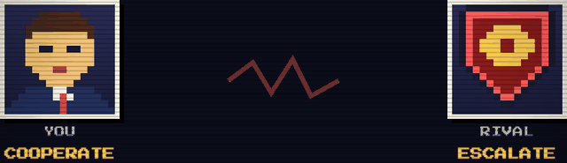
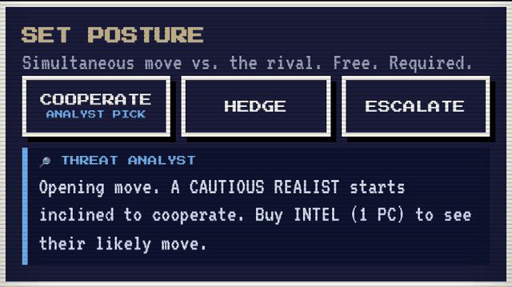
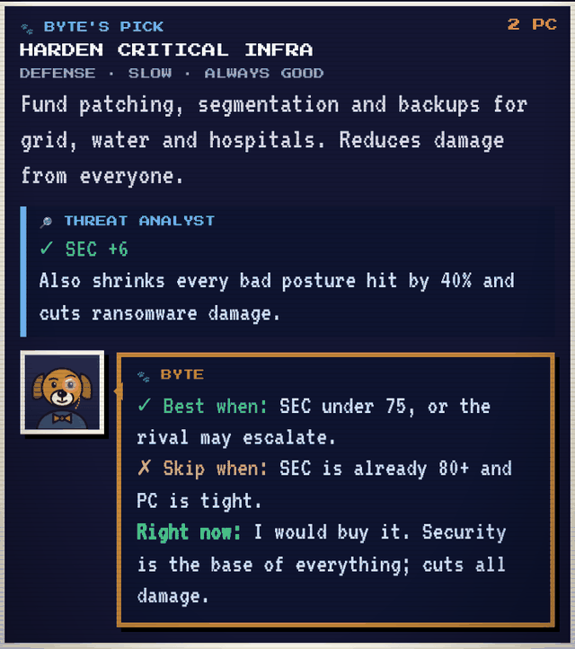
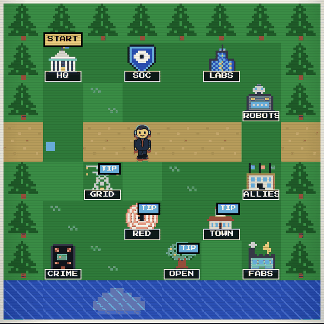

# SIGNAL / NOISE — Superintelligence Wargame

**Find the signal. Survive the noise.**

A think-tank-style, game-theoretic superintelligence wargame in a pixel/Nintendo UI. Play 4, 6 or 8 rounds against a fictional rival state, while profit-driven labs, the open-source commons, criminal syndicates and lawmakers play their own games.

**Play:** https://700799.github.io/ai-war-game/

## What you'll learn

1. Game theory with rivals
2. The security dilemma
3. Attribution under fog
4. Threat modeling first
5. Attacks on SI models
6. Model theft and distillation
7. Open-weight trade-offs
8. Two fronts at once
9. Incentives beat orders
10. Steer, don't stop

| Game theory with rivals | The security dilemma |
|---|---|
|  |  |
| **Threat modeling first** | **Two fronts at once** |
|  |  |

Single static file (`index.html`), served by GitHub Pages from `main`.

Fictional scenario. Actors are archetypes, not real organizations.

## Disclaimer

SIGNAL / NOISE is a fictional, educational simulation about policy trade-offs around superintelligence, cybersecurity and society. It is not a prediction of real events.

- **No real countries.** The rival is an invented state and does not represent any real nation, government or people.
- **No real people or organizations.** All characters, agencies, labs and groups are fictional archetypes. The game is not affiliated with or endorsed by any government, think tank, university or company.
- **Simplified on purpose.** All numbers, probabilities, dates and outcomes are illustrative game mechanics, not research findings or forecasts.
- **Not advice.** Nothing here is legal, financial, security, medical or policy advice.
- **High-level only.** Harms are described in general terms for discussion; the game contains no real techniques or instructions.
